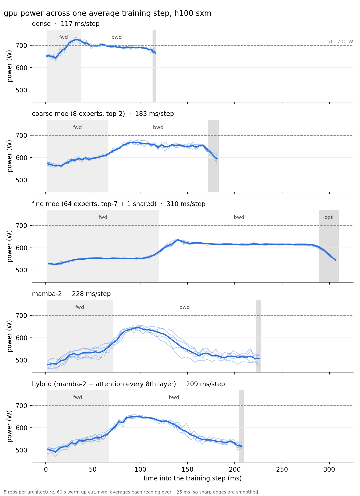

# analyzing ai training power microcycling for different model architectures

**Question:** what shapes the training power waveform, and which decisions reduce grid-relevant swings at the lowest throughput/energy cost?

**Rationale:** data centers are popping up pretty much everywhere nowadays, with big bets on ai infra. there's a lot of push for BTM energy, but most of these data centers still rely on the grid for power. the problem with AI power demand is that it's very spike-y and requires huge influxes and drops, which a traditional grid is not built to handle. there are a lot of solutions in development to address this, with innovations for better supercapacitors or BESS systems to buffer microcycles.

**Purpose:** as someone who's passionate about both infra and model architectures, i wanted to understand if there were also software/architectural decisions we could make to mitigate microcycling and alleviate pressure on the grid + communities relying on those grids. the first step is to actually map different model decisions to their respective energy usage patterns. this repository's purpose is to serve as an experiment that measures those differences exactly.

## results
**a more thorough analysis of the results will be posted soon! for now, here's the high level summary of the results:**

5 reps per architecture on one h100 sxm (700 W tdp), ~350M active params each, batch 16 x 1024 tokens. 210 s runs with the first 60 s cut as warm up, numbers are the mean across reps.

| architecture | step time | mean power | swing (p95 - p5) | throughput | mfu | energy |
|---|---|---|---|---|---|---|
| dense (gpt-2 medium) | 117 ms | 690 W | 123 W (17.6% tdp) | 139.7k tok/s | 34.3% | 4.94 mJ/token |
| coarse moe (8 experts, top-2) | 183 ms | 626 W | 156 W (22.3% tdp) | 89.5k tok/s | 22.0% | 7.00 mJ/token |
| fine moe (64 experts, top-7 + 1 shared) | 310 ms | 587 W | 115 W (16.4% tdp) | 52.9k tok/s | 13.0% | 11.10 mJ/token |
| mamba-2 | 226 ms | 552 W | 210 W (30.0% tdp) | 71.8k tok/s | 16.1% | 7.68 mJ/token |
| hybrid (mamba-2 + attention every 8th layer) | 207 ms | 573 W | 208 W (29.7% tdp) | 78.2k tok/s | 17.4% | 7.33 mJ/token |

dense was at the 700 W power cap for ~90% of training, so its swing is probably squashed by the cap.



power across one average training step (thin lines are each rep, thick line is the mean). nvml only updates every ~100 ms, so readings from thousands of steps are lined up by how far into their step they were and averaged (`python analysis/plot_steps.py`).

## running it
one h100 sxm vm (~4-5 gpu hrs), analysis on my mac. edit code on the mac and re-run the step 1 rsync.

**1. copy code over** (mac)
```
rsync -av --exclude runs --exclude data --exclude __pycache__ ./ ubuntu@<ip>:ai_energy_usage/
ssh ubuntu@<ip>
cd ai_energy_usage
```

**2. install + data** (vm, mamba-ssm compile takes 20-40 min)
```
pip install -r requirements.txt && pip install --no-build-isolation mamba-ssm causal-conv1d
python data.py
```

**3. calibrate** (vm): `python calibration.py`, then set `nyquist_hz` and `nvml_window_s` at the top of `metrics.py` from its output

**4. smoke test** (vm): run `python train.py <arch> 0` for each of baseline, moe, moe_fine, mamba, hybrid until a few steps print, ctrl-c, then `rm -rf runs/*_0`

**5. pick batch_size** (in `train.py`): highest value where dense sits at ~85-90% of tdp and moe_fine still fits in memory

**6. sweep** (vm, ~3 hrs)
```
tmux new -s run    # ctrl-b d to detach, tmux attach -t run to come back
python sweep.py
```

**7. analyze** (mac)
```
rsync -av ubuntu@<ip>:ai_energy_usage/runs/ runs/
python metrics.py  # -> runs/summary.csv
```

**8. shut down the vm**


## documenting my run

calibration.py results:
```
root@dbcf7035f910:/workspace/ai_energy_usage# python calibration.py
{'name': 'NVIDIA H100 80GB HBM3', 'uuid': 'GPU-463416d3-b00c-5a6e-8bb0-48351f854ce8', 'vbios': '96.00.DA.00.0C', 'driver': '595.91.07', 'tdp_w': 700.0, 'power_limit_w': 700.0, 'serial': '1652324103948'}
10 ms done, last power 500 W
20 ms done, last power 585 W
50 ms done, last power 337 W
100 ms done, last power 581 W
130 ms done, last power 784 W
200 ms done, last power 355 W
500 ms done, last power 127 W
1000 ms done, last power 127 W
2000 ms done, last power 126 W
 period_ms    true_hz  seen_hz  swing_w  attenuation
        10 100.000000 2.197266 147.9780     0.237024
        20  50.000000 0.488281 244.7320     0.392000
        50  20.000000 0.061035 485.8038     0.778138
       100  10.000000 0.061035 362.6210     0.580829
       130   7.692308 2.319336 708.0280     1.134086
       200   5.000000 5.004883 609.8670     0.976856
       500   2.000000 2.014160 615.0480     0.985155
      1000   1.000000 1.037598 652.9700     1.045897
      2000   0.500000 0.488281 624.3160     1.000000
nvml updates every ~100.0 ms -> set nyquit_hz = 5.0 in metrics.py
```

next, i ran some smoke tests to make sure everything was running right. fixed some bugs. used the dense baseline to determine the batch size that would keep it at ~85-90% of tdp.
```
root@dbcf7035f910:/workspace/ai_energy_usage# python train.py baseline 0
baseline rep 0: dense, 354.9M params (354.9M active)
step 0: loss 11.0850, 49,037 tok/s, mfu 12.0%, 771 W
step 100: loss 7.6358, 139,871 tok/s, mfu 34.3%, 669 W
```
669 W is about 96% of TDP, so we are keeping batch_size at 16.

next up, i just ran sweep.py. all the terminal output and results were saved to a runs folder. the whole run took about 2 hours.

